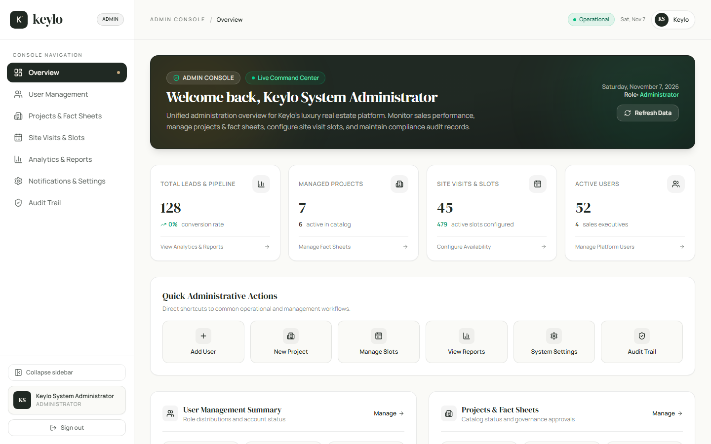
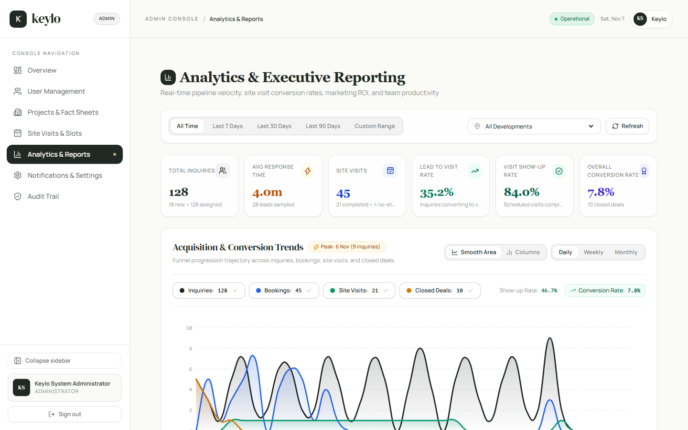
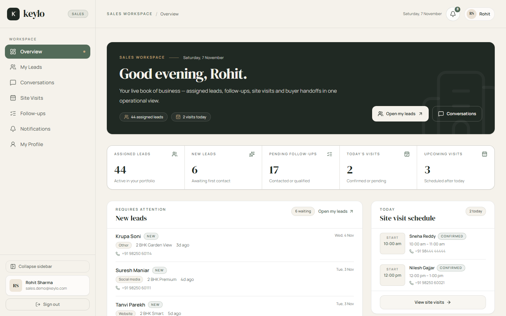
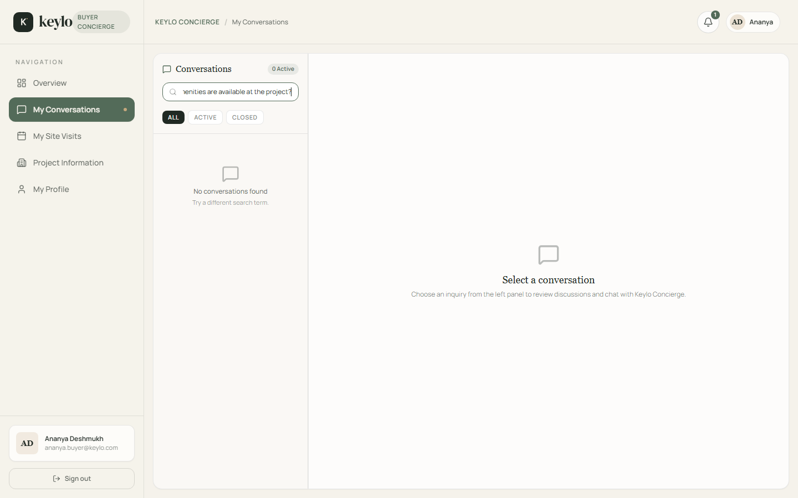
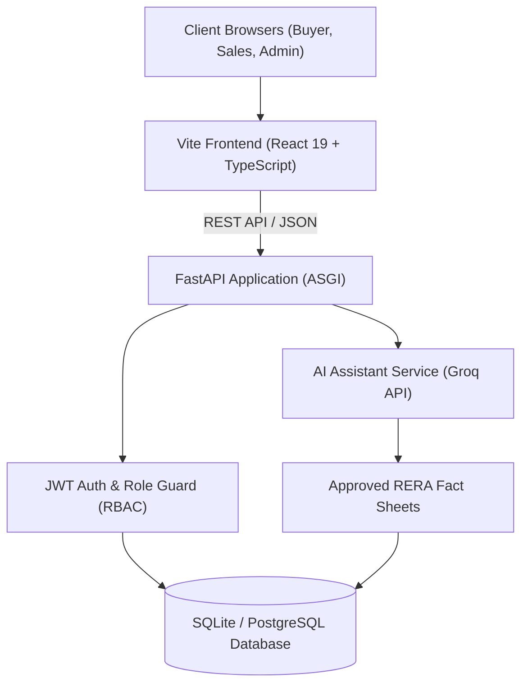

<p align="center">
  <picture>
    <source media="(prefers-color-scheme: dark)" srcset="docs/assets/keylo-logo-dark.png">
    <source media="(prefers-color-scheme: light)" srcset="docs/assets/keylo-logo-light.png">
    
  </picture>
</p>

<h3 align="center">Conversational Real Estate Sales & Site Visit Automation Platform</h3>

<p align="center">
  An end-to-end real estate engagement platform integrating multilingual AI assistance, verified RERA fact sheets, role-based lead workflows, and automated site visit scheduling.
</p>

<p align="center">
  
  
  
  
  
  
  
</p>

<p align="center">
  <a href="#key-features">Key Features</a> •
  <a href="#screenshots">Screenshots</a> •
  <a href="#tech-stack">Tech Stack</a> •
  <a href="#architecture-overview">Architecture</a> •
  <a href="#quick-start--local-setup">Quick Start</a> •
  <a href="#environment-variables">Environment</a> •
  <a href="#demo-accounts">Demo Accounts</a> •
  <a href="#running-tests">Testing</a>
</p>

---

## Key Features

- **Multilingual Conversational AI**: Instant buyer support in **English**, **Hindi**, and **Gujarati**, strictly grounded in approved project fact sheets with strict pricing restriction guards.
- **Sales Executive Workspace**: Real-time lead queues, priority-tiered follow-ups (*Due Today*, *Overdue*, *Upcoming*), and seamless AI-to-human handoffs.
- **Site Visit Lifecycle Automation**: Self-serve calendar booking with project-level capacity enforcement, automated 24h & 2h reminder tracking, and visit status management (*Confirmed*, *Completed*, *Cancelled*, *No-Show*).
- **Executive Admin Console**: Live conversion funnel KPIs, bespoke SVG spline trend charts, RERA fact-sheet moderation, and an immutable administrative audit log.
- **Role-Based Access Control (RBAC)**: Strict data isolation and API authorization across `ADMIN`, `SALES_EXECUTIVE`, and `BUYER` roles.
- **Marketing Spend Attribution**: Source-level spend tracking (Google Ads, Meta Ads, Portals, Referrals) with automatic Cost-Per-Lead (CPL) and Cost-Per-Visit (CPV) calculations.

---

## Screenshots

| Admin Executive Overview | Acquisition & Conversion Trends |
| :---: | :---: |
|  |  |

| Sales Executive Workspace | Multilingual AI Assistant |
| :---: | :---: |
|  |  |

---

## Tech Stack

| Layer | Technology | Details |
| :--- | :--- | :--- |
| **Frontend** | React 19, TypeScript, Vite | Tailwind CSS, Lucide React, Headless UI, bespoke SVG charting |
| **Backend** | Python 3.12+, FastAPI | SQLAlchemy 2.0, Pydantic v2, Alembic, AnyIO, Uvicorn |
| **Database** | SQLite (Dev) / PostgreSQL (Prod) | Normalized schema with foreign keys, checks, and partial indexes |
| **AI / LLM** | Groq API (`openai/gpt-oss-120b`) | Deterministic fact-retrieval prompt engine and multi-turn dialogue |
| **Testing** | Pytest, Puppeteer | 224 unit/integration tests and headless end-to-end browser journeys |

---

## Architecture Overview



### Directory Structure

```text
KEYLO/
├── backend/
│   ├── alembic/                # Alembic database migration scripts
│   ├── app/
│   │   ├── api/v1/             # REST endpoints (auth, leads, visits, analytics, etc.)
│   │   ├── core/               # Configuration, security, and logging
│   │   ├── db/                 # SQLAlchemy Base and database session
│   │   └── modules/            # Domain modules (leads, bookings, settings, etc.)
│   ├── scripts/                # Database setup, seeding, and demo tooling
│   └── tests/                  # Pytest backend test suite (224 tests)
├── frontend/
│   ├── public/                 # Static assets and favicon
│   ├── src/
│   │   ├── components/         # Reusable UI components, layout, and charts
│   │   ├── pages/              # Portal pages (Buyer, Sales, Admin)
│   │   └── services/           # Axios HTTP API clients and typed schemas
│   └── scripts/                # Automated Puppeteer verification suites
└── docs/
    ├── assets/                 # Brand logo assets (SVG, PNG)
    └── screenshots/            # Application interface captures
```

---

## Quick Start / Local Setup

### Prerequisites
- **Python**: 3.12 or 3.13
- **Node.js**: 20.x or higher (with npm)
- **Git**

### 1. Clone & Environment Setup
```bash
git clone https://github.com/MahanteshPatil1214/KEYLO.git
cd KEYLO
```

### 2. Backend Setup
```bash
cd backend

# Create and activate virtual environment
# Windows:
python -m venv .venv
.venv\Scripts\activate
# Linux/macOS:
# python3 -m venv .venv
# source .venv/bin/activate

# Install dependencies
pip install -r requirements.txt

# Configure environment file
cp .env.example .env

# Run database migrations to head
alembic upgrade head

# Seed initial developer data
python scripts/setup_dev_database.py

# Start FastAPI server on http://127.0.0.1:8000
uvicorn app.main:app --host 127.0.0.1 --port 8000 --reload
```

Interactive API documentation will be available at [`http://127.0.0.1:8000/docs`](http://127.0.0.1:8000/docs).

### 3. Frontend Setup
```bash
# In a new terminal window:
cd frontend

# Install npm dependencies
npm install

# Start Vite development server on http://127.0.0.1:5173
npm run dev

# Or build for production preview
npm run build
npm run preview
```

### 4. Realistic 1-Month Demo Environment (Ahmedabad 2/3 BHK)
To populate the database with a 30-day operational demo environment (45 buyers, 3 Ahmedabad residential projects, 125 leads, visit slots, bookings, follow-ups, and marketing spend):

```bash
cd backend
python scripts/prepare_demo_environment.py

# To reset and remove only generated demo records:
python scripts/prepare_demo_environment.py --reset
```

---

## Docker Compose (Full Stack)

Spin up the entire stack — PostgreSQL, FastAPI backend, and Vite frontend — with a single command:

```bash
# From the repository root
docker compose up --build

# Backend API:  http://localhost:8000
# Frontend:     http://localhost:5173
# API docs:     http://localhost:8000/docs
# Database:     localhost:5432
```

**What's included**

| Service | Port | Details |
|---------|------|---------|
| `db` | 5432 | PostgreSQL 16 (persisted via `keylo_postgres_data` volume) |
| `backend` | 8000 | FastAPI app with auto-reload (`--reload`) |
| `frontend` | 5173 | Vite dev server with hot module replacement |

**Environment variables**

Create a `.env` file at the repository root (or export variables) to override defaults:

| Variable | Default | Description |
|----------|---------|-------------|
| `POSTGRES_DB` | `keylo_db` | Database name |
| `POSTGRES_USER` | `keylo` | Database user |
| `POSTGRES_PASSWORD` | `change-me-local-dev` | Database password |
| `POSTGRES_PORT` | `5432` | Host port for PostgreSQL |
| `JWT_SECRET_KEY` | `change-me-...` | JWT signing secret (change in production) |
| `GROQ_API_KEY` | *(empty)* | Groq LLM API key for AI assistant |

**Stop and clean up**

```bash
docker compose down          # Stop and remove containers
docker compose down -v       # Also remove database volume (destroys all data)
```

**Seed demo data**

The stack starts with an empty database. To populate it with the realistic
1-month Ahmedabad demo environment (45 buyers, 3 projects, 125 leads, visits,
follow-ups, marketing spend):

```bash
# Seed demo data (idempotent — safe to re-run)
docker compose --profile seed up seed

# Reset and re-seed from scratch
docker compose --profile seed up seed  # script has built-in --reset handling
# or reset first:
docker compose exec backend python scripts/prepare_demo_environment.py --reset
```

The seed script is idempotent — running it repeatedly won't duplicate or
corrupt data. It also preserves real user accounts.

**Rebuild after code changes**

```bash
docker compose up --build    # Rebuild images and restart
```

Backend source changes are picked up automatically via uvicorn `--reload`; frontend changes via Vite HMR.

---

## Environment Variables

Configure `backend/.env` based on `backend/.env.example`:

| Variable | Description | Default / Example |
| :--- | :--- | :--- |
| `DATABASE_URL` | SQLAlchemy connection string | `sqlite:///./keylo_dev.db` |
| `JWT_SECRET_KEY` | Secret key for JWT signing | *(Generate secure 32+ byte string)* |
| `JWT_ALGORITHM` | Cryptographic algorithm for JWT | `HS256` |
| `ACCESS_TOKEN_EXPIRE_MINUTES` | Session token lifetime | `30` |
| `CORS_ALLOWED_ORIGINS` | Permitted client browser origins | `["http://localhost:5173", "http://127.0.0.1:5173"]` |
| `GROQ_API_KEY` | Groq LLM API key for assistant chat | *(Optional for dev / required for live LLM)* |
| `GROQ_MODEL` | Target language model | `openai/gpt-oss-120b` |

---

## Demo Accounts

> [!IMPORTANT]
> The credentials below are provided strictly for **local development and demonstration**.

| Portal | Role | Email | Password | Primary URL |
| :--- | :--- | :--- | :--- | :--- |
| **Admin Console** | `ADMIN` | `admin.demo@keylo.com` | `Admin@123` | [http://127.0.0.1:5173/admin](http://127.0.0.1:5173/admin) |
| **Sales Workspace** | `SALES_EXECUTIVE` | `sales.demo@keylo.com` | `Sales@123` | [http://127.0.0.1:5173/sales](http://127.0.0.1:5173/sales) |
| **Buyer Portal** | `BUYER` | `buyer.demo@keylo.com` | `Buyer@123` | [http://127.0.0.1:5173/buyer](http://127.0.0.1:5173/buyer) |

---

## Running Tests

### 1. Backend Pytest Suite
Runs all 224 unit, API, integration, and security tests:
```bash
cd backend
python -m pytest backend/tests -v
```

### 2. Frontend Typecheck & Build
Validates TypeScript typings and compiles production assets:
```bash
cd frontend
npm run build
```

### 3. Automated Browser End-to-End Verification
Executes real-browser end-to-end flows across all three portals:
```bash
node frontend/scripts/verify-full-e2e-suite.mjs
```

### 4. Demo Environment Verification
Validates the seeded Ahmedabad demo environment, dashboards, and metrics:
```bash
node frontend/scripts/verify-demo-environment.mjs
```

---

## License

This project is licensed under the [MIT License](LICENSE).
